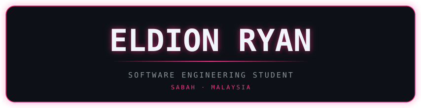
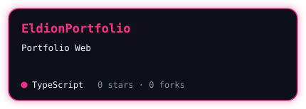
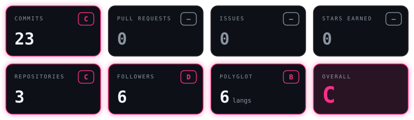
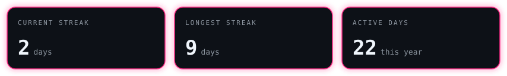
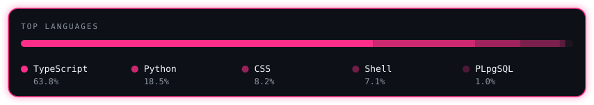
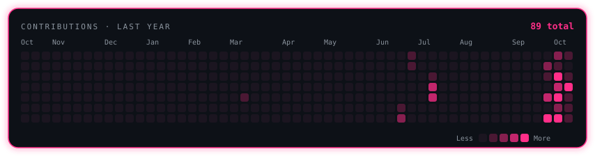
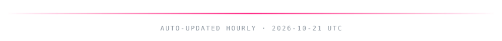

<div align="center">



[](https://git.io/typing-svg)

<a href="mailto:nayrnoidle@gmail.com">
  
</a>
<a href="https://www.linkedin.com/in/eldion-ryan-godius-897064235" target="_blank">
  
</a>
<a href="https://eldionryanportfolio.vercel.app/" target="_blank">
  
</a>

</div>

<br/>

## About Me

```js
const eldion = {
  focus:     "Web development, front to back",
  currently: "Shipping side projects",
  open_to:   "Collaborations",
};
```

<br/>

## Tech Stack

<div align="center">

<!-- STACK:START -->


<!-- STACK:END -->

</div>

<br/>

## Projects

<div align="center">

<!-- PROJECTS:START -->
<a href="https://github.com/ElXprogramming/EldionPortfolio"></a>
<!-- PROJECTS:END -->

</div>

<br/>


## GitHub Stats

<div align="center">






<br/>

> *"Talk is cheap. Show me the code."* — Linus Torvalds



</div>
